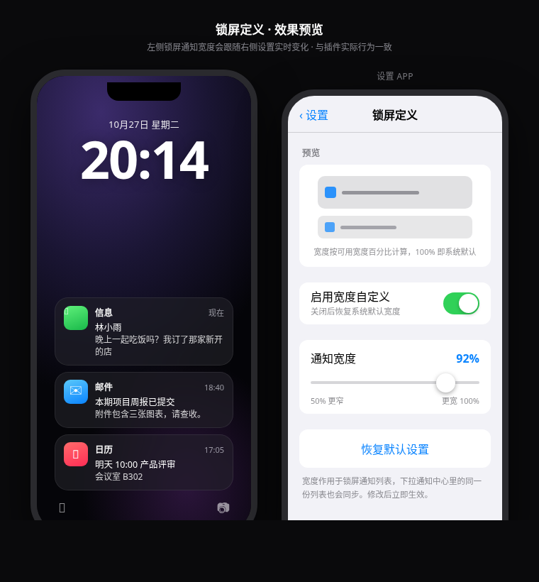

# 锁屏定义 (LockScreenDefine)

自定义 iOS 锁屏通知宽度的越狱插件（Tweak），适用于 **Dopamine 2 隐根（RootHide）· iOS 16.2 · arm64e**。



## 功能

- **设置入口**：设置 App 里出现「锁屏定义」入口，图标 + 中文界面
- **开关项**：「启用宽度自定义」，关闭即恢复系统默认
- **拉取数值调大小**：滑块 50%–100%，按「可用宽度百分比」调节通知卡片宽度，宽度始终水平居中
- **实时预览**：设置页内置示意卡片，拖动滑块立即看到宽度变化
- **实时生效**：写配置后通过 Darwin 通知广播，锁屏无需注销即可刷新
- **恢复默认**：一键回到 92%（iPhone）/ 76%（iPad）默认值
- iPhone 与 iPad 配置互相独立

## 构建

使用 [roothide/theos](https://github.com/roothide/theos)（与原版 Theos 100% 兼容，自动适配隐根）：

```bash
bash -c "$(curl -fsSL https://raw.githubusercontent.com/roothide/theos/master/bin/install-theos)"

cd LockScreenDefine
make package FINALPACKAGE=1
# 产物：packages/com.lockdefine.lockscreendefine_1.0.0_iphoneos-arm64.deb
```

安装：

```bash
# 通过 Sileo / Zebra 添加本地 deb，或 SSH：
dpkg -i com.lockdefine.lockscreendefine_1.0.0_iphoneos-arm64.deb
killall -9 SpringBoard
```

## 工程结构

```
LockScreenDefine/
├── Makefile                      # 主构建（THEOS_PACKAGE_SCHEME=roothide）
├── control                       # deb 包信息
├── LockScreenDefine.plist        # Tweak 注入过滤器（SpringBoard/NotificationCenter）
├── Tweak/
│   ├── LockScreenDefine.xm       # 核心 Hook：调整通知宽度
│   └── LockScreenDefine.entitlements   # 隐根所需权限
├── Shared/
│   └── LDCommon.h                # Tweak 与设置页共用的配置读写（含 jbroot 解析）
├── Prefs/
│   ├── Makefile                  # 设置 bundle 构建
│   └── LDWRootListController.m   # 设置界面（纯 UIKit 自绘，不依赖 Cephei）
└── layout/
    └── Library/
        ├── PreferenceBundles/LockScreenDefinePrefs.bundle/   # 设置 bundle + 图标
        └── PreferenceLoader/Preferences/LockScreenDefine.plist  # 设置入口
```

## 隐根（RootHide）适配要点

1. **打包方案**：`export THEOS_PACKAGE_SCHEME = roothide`（Makefile 已配置）。
   隐根的越狱根是随机目录（不是固定 `/var/jb`），roothide/theos 会自动处理链接路径。
2. **路径解析**：所有越狱内路径都经 `Shared/LDCommon.h` 的 `LDResolveJailbreakPath()`：
   - 在 roothide/theos 下走官方 `jbroot()` API（`#include <roothide.h>`）；
   - 同一份代码兼容 rootful / rootless（编译期自动降级）。
3. **配置存放**：按 RootHide 官方建议放在 `jbroot:/var/mobile/Library/Preferences/` 下
   （隐根中 tweak 只能自由写 jbroot 的 `/var/` 目录）。
4. **沙盒权限**：Tweak 与设置 bundle 都签了 `platform-application` +
   `com.apple.private.security.no-sandbox` 等 entitlements。
5. **实时刷新**：配置变更通过 Darwin 通知 `com.lockdefine.prefs/Reload` 广播，
   SpringBoard / NotificationCenter 里的 Tweak 收到后立即重读并刷新布局。

## 实现原理（Tweak 侧）

不依赖任何私有类名（iOS 小版本之间会变），只 Hook 公开的 UIKit 方法，按几何特征筛选通知列表：

| Hook 点 | 作用 |
|---|---|
| `-[UICollectionView layoutAttributesForElementsInRect:]` | 布局阶段改 attributes，上屏即目标宽度，无抖动 |
| `-[UICollectionView layoutSubviews]` | 兜底：处理已上屏的 Cell |
| `-[UICollectionViewCell layoutSubviews]` | Cell 自行重排时把宽度压回去 |

并递归修正 Cell 内部「横向撑满」的子视图，保证外层变宽时内部卡片同步变宽。
横向小组件、设置页列表等非满宽列表不会被误伤（宽度 40% 以下或超过容器的直接跳过）。

## 调试

SSH 到设备后：

```bash
# 开启日志
touch /var/mobile/.lddebug   # 或直接：
LDDEBUG=1 # 在 SpringBoard 环境里查看 NSLog（[LockScreenDefine] 前缀）
```

代码中的日志开关为环境变量 `LDDEBUG`，可用 `ldlog` 类工具查看。

## 兼容性

| 环境 | 状态 |
|---|---|
| Dopamine 2 隐根 (RootHide) · iOS 15–16.5 | ✅ 目标环境 |
| Dopamine rootless (`/var/jb`) | ✅ 同一份代码，重编译即可 |
| rootful (palera1n / unc0ver) | ✅ 同一份代码，重编译即可 |
